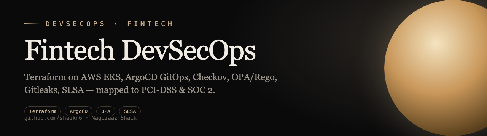
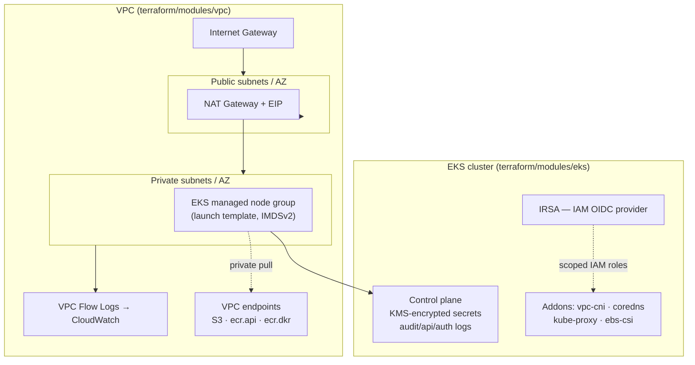

<p align="center"></p>

<div align="center">

# fintech-devsecops-pipeline

[](https://github.com/shaikn6/fintech-devsecops-pipeline/actions/workflows/ci-security.yml)
[](LICENSE)
[](terraform/modules)

**Shift-left DevSecOps reference platform for fintech workloads — hardened Terraform (VPC + private EKS with IRSA), an OPA/Rego admission policy set, a multi-scanner CI security gate, and ArgoCD GitOps delivery.**

</div>

A reference implementation: the validation, lint and policy checks in [Quickstart](#quickstart) run offline and
in CI, but the platform has not been deployed to a live AWS account or cluster.

## Architecture

Two views of what the repo actually defines: the AWS network/compute topology
(Terraform `vpc` + `eks` modules) and the DevSecOps pipeline stage gates
(`.github/workflows` + `argocd/`).

### Infrastructure topology (Terraform)



### DevSecOps stage gates (CI/CD)


## Key Components

| Component | Technology | What's in the repo |
|-----------|-----------|--------------------|
| Network | Terraform `vpc` module | VPC, public/private subnets per AZ, NAT, IGW, flow logs, S3 + ECR VPC endpoints |
| Compute | Terraform `eks` module | Private EKS control plane (KMS-encrypted secrets, audit logging), managed node group, IRSA OIDC provider, vpc-cni/coredns/kube-proxy/ebs-csi addons |
| CI security gate | GitHub Actions (`ci-security.yml`) | terraform fmt/validate, helm lint/template, Checkov, OPA check + unit tests, Conftest on the rendered chart, Gitleaks |
| Admission policy | OPA / Rego (`policies/rego`) | Container security, image signing, network-policy `deny` rules, each covered by unit tests (`*_test.rego`); `policies/conftest` applies them to rendered manifests |
| Compliance | Scheduled scan (`compliance-scan.yml` + `scripts/compliance_reporter.py`) | Weekly Trivy/tfsec/pip-audit/CIS-K8s sweep → HTML+JSON report, auto-issue on critical findings |
| GitOps | ArgoCD (`argocd/`) | Self-healing app + AppProject, prune + auto-sync to EKS |
| Delivery artifact | Helm (`helm/fintech-api`) | Deployment, service, ingress, HPA, NetworkPolicy, configmap, ServiceAccount |

## Admission Policy Example

A real deny rule from `policies/rego/container-security.rego`:

```rego
# DENY: privileged containers
deny contains msg if {
    input.request.kind.kind == "Pod"
    container := input.request.object.spec.containers[_]
    container.securityContext.privileged == true
    msg := sprintf(
        "Container '%v' is privileged. Privileged containers are forbidden.",
        [container.name]
    )
}
```

The same file also denies containers missing CPU/memory requests and
limits, missing `readOnlyRootFilesystem: true`, and missing
`capabilities.drop: ["ALL"]`.

The policies are unit-tested, not just syntax-checked: `opa test policies/`
runs a test that triggers every deny rule, a compliant Pod and NetworkPolicy
that must pass every rule at once, and allow tests for the inputs a rule must
not reject (a pod-level non-root context, an unset `privileged` field, a
digest-pinned image, an empty selector on `default-deny-all`, and so on). CI
fails if any test fails. CI also renders the Helm chart and evaluates it
against the same rules with Conftest, so a chart change that violates a policy
fails the build. The policies are not deployed to a cluster admission
controller by this repo.

## Quickstart

```bash
git clone https://github.com/shaikn6/fintech-devsecops-pipeline
cd fintech-devsecops-pipeline

# Validate the Terraform modules (no backend / no credentials needed)
terraform fmt -check -recursive
for d in terraform/modules/*/; do
  terraform -chdir="$d" init -backend=false && terraform -chdir="$d" validate
done

# Lint + render the Helm chart
helm lint helm/fintech-api
helm template fintech-api helm/fintech-api

# Check and unit-test the OPA/Rego admission policies
opa check policies
opa test policies/ -v

# Evaluate the rendered chart against the policies (requires conftest)
helm template fintech-api helm/fintech-api --namespace fintech-prod \
  | conftest test --policy policies/ -

# Register the GitOps application (requires an ArgoCD-managed cluster)
kubectl apply -f argocd/projects/fintech-project.yaml
kubectl apply -f argocd/apps/fintech-app.yaml
```

> The `eks`/`vpc` modules are consumed by a root configuration that supplies a
> backend and AWS credentials; the commands above run the same validation,
> linting, and policy checks the CI security pipeline runs, fully offline.
> Terraform validate, Helm lint, the OPA check and unit tests, the Conftest
> chart evaluation, and Gitleaks are hard gates that fail the build; Checkov
> is advisory and reports findings without blocking.
>
> This is a reference implementation. It has not been deployed to a live AWS
> account or cluster.

## Directory Structure

```
├── .github/workflows/    # ci-security, compliance-scan
├── terraform/modules/    # vpc, eks (cluster + IRSA + addons)
├── helm/fintech-api/     # Helm chart: deployment, svc, ingress, hpa, netpol, serviceaccount
├── argocd/               # ArgoCD Application + AppProject (GitOps)
├── policies/rego/        # OPA admission policies (container, image, network) + unit tests
├── policies/conftest/    # Conftest entrypoint that applies the policies to rendered manifests
├── slsa/                 # SLSA build-provenance workflow definition (not wired into CI)
├── k8s/                  # RBAC manifests
└── scripts/              # compliance_reporter.py
```

## DR design (not implemented in this repo)

This section is a design note, not a description of working code. The repo
contains no backup tooling, no second-region configuration, no database, no DNS
failover, no root Terraform configuration or remote state backend, and no
deploy or DR workflow. Nothing here has been deployed or failover-tested, so
there are no measured RTO/RPO figures.

### What the repo does provide toward recovery

| Asset | Mechanism in this repo | Recovery property |
|-------|------------------------|-------------------|
| Cluster infrastructure | Terraform `vpc` + `eks` modules | Network and cluster topology are defined in code and can be re-applied by a root configuration (not included) |
| Application config | ArgoCD `Application` / `AppProject` with `prune: true`, `selfHeal: true` (`argocd/`) | Desired state lives in Git; a cluster with ArgoCD pointed at this repo re-syncs the chart |
| Delivery artifact | Helm chart `helm/fintech-api` (image tag by default, optional `image.digest`) | Repeatable render of the same manifests |
| Workload placement | `topologySpreadConstraints` + pod anti-affinity in the chart; subnets per AZ in the `vpc` module | Replicas spread across nodes and zones |
| Secrets at rest | KMS envelope encryption for EKS secrets; IRSA instead of static node credentials | No long-lived cloud credentials on nodes |
| Audit trail | EKS control-plane logs + VPC Flow Logs → CloudWatch | Logs are stored outside the cluster |

### What a full DR design would add

None of the following exists in this repo:

- A root Terraform configuration with a remote, versioned, locked state backend, plus a second-region instance of it.
- Cluster-state backup and restore (for example Velero) for anything not managed through Git.
- A replicated data tier with point-in-time recovery; the repo defines no datastore.
- DNS health checks and failover routing between regions.
- Images pinned by digest by default, with signature verification enforced at admission (the Rego policy only checks an annotation).
- Defined RTO/RPO targets per failure scenario, a written runbook, and a scheduled restore/failover test that proves them.

## Tech Stack

Terraform 1.9 (CI pins 1.9.5) · AWS (VPC, EKS, IAM/IRSA, KMS, ECR, CloudWatch) · Helm · ArgoCD · OPA/Rego · Conftest · Checkov · tfsec · Trivy · Gitleaks · Python (compliance reporter)

## License

MIT
