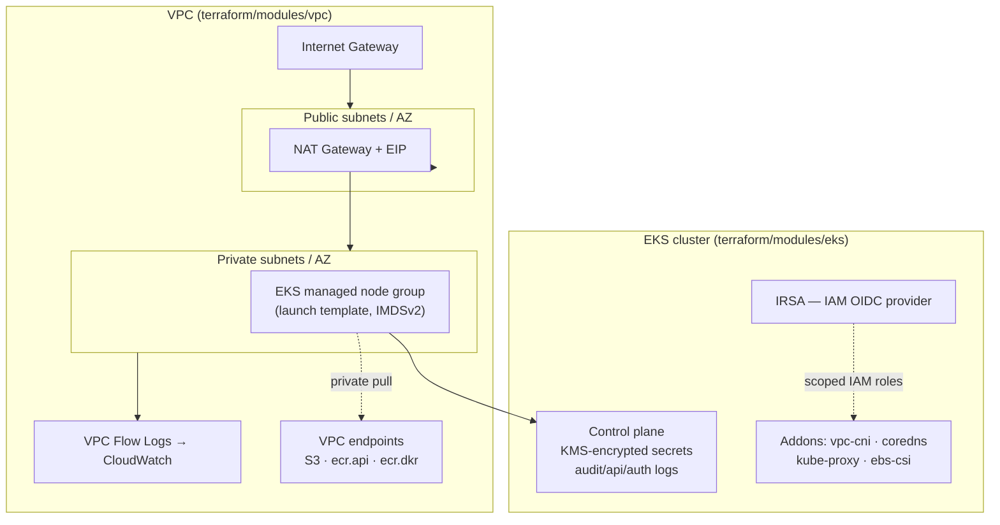
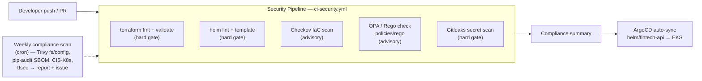

<p align="center"></p>

<div align="center">

# Fintech DevSecOps Pipeline

[](https://github.com/shaikn6/fintech-devsecops-pipeline/actions)
[](https://terraform.io)
[](https://kubernetes.io)
[](LICENSE)
[](https://argoproj.github.io/cd/)

**Shift-left DevSecOps reference platform for fintech workloads — hardened Terraform (VPC + private EKS with IRSA), an OPA/Rego admission policy set, a multi-scanner CI security gate, and ArgoCD GitOps delivery.**

</div>

## Architecture

Two views of what the repo actually defines: the AWS network/compute topology
(Terraform `vpc` + `eks` modules) and the DevSecOps pipeline stage gates
(`.github/workflows` + `argocd/`).

### Infrastructure topology (Terraform)



### DevSecOps stage gates (CI/CD)



## Key Components

| Component | Technology | What's in the repo |
|-----------|-----------|--------------------|
| Network | Terraform `vpc` module | VPC, public/private subnets per AZ, NAT, IGW, flow logs, S3 + ECR VPC endpoints |
| Compute | Terraform `eks` module | Private EKS control plane (KMS-encrypted secrets, audit logging), managed node group, IRSA OIDC provider, vpc-cni/coredns/kube-proxy/ebs-csi addons |
| CI security gate | GitHub Actions (`ci-security.yml`) | terraform fmt/validate, helm lint/template, Checkov, OPA/Rego, Gitleaks |
| Admission policy | OPA / Rego (`policies/rego`) | Container security, image signing, network-policy `deny` rules |
| Compliance | Scheduled scan (`compliance-scan.yml` + `scripts/compliance_reporter.py`) | Weekly Trivy/tfsec/pip-audit/CIS-K8s sweep → HTML+JSON report, auto-issue on critical findings |
| GitOps | ArgoCD (`argocd/`) | Self-healing app + AppProject, prune + auto-sync to EKS |
| Delivery artifact | Helm (`helm/fintech-api`) | Deployment, service, ingress, HPA, NetworkPolicy, configmap |

## Admission Policy Example

A real deny rule from `policies/rego/container-security.rego`:

```rego
# DENY: privileged containers
deny[msg] if {
    input.request.kind.kind == "Pod"
    container := input.request.object.spec.containers[_]
    container.securityContext.privileged == true
    msg := sprintf(
        "Container '%v' is privileged. Privileged containers are forbidden.",
        [container.name]
    )
}
```

The same file also denies containers missing CPU/memory requests and
limits, missing `readOnlyRootFilesystem: true`, and missing
`capabilities.drop: ["ALL"]`.

## Quick Start

```bash
git clone https://github.com/shaikn6/fintech-devsecops-pipeline
cd fintech-devsecops-pipeline && cp .env.example .env

# Validate the Terraform modules (no backend / no credentials needed)
terraform fmt -check -recursive
for d in terraform/modules/*/; do
  terraform -chdir="$d" init -backend=false && terraform -chdir="$d" validate
done

# Lint + render the Helm chart
helm lint helm/fintech-api
helm template fintech-api helm/fintech-api

# Check the OPA/Rego admission policies
opa check policies/rego

# Register the GitOps application (requires an ArgoCD-managed cluster)
kubectl apply -f argocd/projects/fintech-project.yaml
kubectl apply -f argocd/apps/fintech-app.yaml
```

> The `eks`/`vpc` modules are consumed by a root configuration that supplies a
> backend and AWS credentials; the commands above run the same validation,
> linting, and policy checks the CI security pipeline runs, fully offline.
> Terraform validate, Helm lint, and Gitleaks are hard gates that fail the
> build; Checkov and the OPA/Rego check are advisory and report findings
> without blocking.

## Directory Structure

```
├── .github/workflows/    # ci-security, compliance-scan
├── terraform/modules/    # vpc, eks (cluster + IRSA + addons)
├── helm/fintech-api/     # Helm chart: deployment, svc, ingress, hpa, netpol
├── argocd/               # ArgoCD Application + AppProject (GitOps)
├── policies/rego/        # OPA admission policies (container, image, network)
├── slsa/                 # SLSA build-provenance workflow definition (not wired into CI)
├── k8s/                  # RBAC manifests
└── scripts/              # compliance_reporter.py
```

## Disaster Recovery

Fintech workloads carry a regulatory expectation (FFIEC Appendix J, GLBA
safeguards) that recovery objectives are *defined, documented, and tested* — not
just assumed. This section states the recovery design for the platform and the
objectives each tier is engineered to.

### What the repo already makes recoverable

| Asset | Mechanism in this repo | Recovery property |
|-------|------------------------|-------------------|
| Cluster infrastructure | Terraform `vpc` + `eks` modules, remote S3 state (versioned) + DynamoDB lock | Entire VPC/EKS topology is redeployable from code into any region |
| Application + platform config | ArgoCD `Application` / `AppProject` with `prune: true`, `selfHeal: true` (`argocd/`) | Desired state lives in Git; a fresh cluster re-syncs to identical workloads |
| Delivery artifact | Helm chart `helm/fintech-api` (pinned image digests) | Deterministic re-deploy, no drift between DR and primary |
| Node group | Multi-AZ EKS managed node group (`terraform/modules/eks`) | Single-AZ loss is self-healing — no human action, no data loss |
| Secrets | KMS-encrypted at rest in etcd; IRSA (no static cloud creds on nodes) | No secret material to exfiltrate or manually restore from a node |
| Audit trail | EKS control-plane `api`/`audit`/`authenticator` logs + VPC Flow Logs → CloudWatch | Forensic timeline survives cluster loss |

### Recovery objectives

| Scenario | Blast radius | RTO (target) | RPO (target) | Strategy |
|----------|-------------|--------------|--------------|----------|
| Single AZ failure | One AZ of nodes | **~0** (transparent) | **0** | Multi-AZ node group + `topologySpreadConstraints`; pods reschedule automatically, other AZs absorb load |
| Node group / cluster-plane corruption | One cluster | **≤ 30 min** | **0** for Git-managed state | `terraform apply` rebuilds EKS in-region; ArgoCD re-syncs from Git; stateful data untouched in RDS/Aurora |
| Full region outage | Entire primary region | **≤ 4 h** | **≤ 15 min** | Terraform re-applies stack into the DR region; Velero restores namespaced state from cross-region S3; Aurora global-database secondary is promoted |
| Accidental / malicious data deletion | One datastore or namespace | **≤ 1 h** | **≤ 5 min** | Aurora PITR (5-min granularity); Velero namespace-scoped restore; S3 Object Lock on backup buckets blocks tampering |
| Compromised supply-chain artifact | One release | **≤ 15 min** | **0** | ArgoCD rollback to the previous cosign-verified image digest; SLSA provenance identifies the bad build |

> RTO/RPO are engineering targets for the reference design, not measured SLAs of a
> running production system. They assume backups and the DR-region Terraform
> workspace are exercised on the cadence below.

### Failover strategy

- **Data tier — active/passive.** Aurora PostgreSQL **global database**: a
  primary-region writer with a continuously-replicated reader in the DR region
  (typical cross-region replica lag < 1 s). Regional failover is a managed
  promotion of the secondary; the application picks up the new writer endpoint
  from External Secrets, no redeploy required.
- **Compute tier — pilot light.** The DR region holds a minimal always-on
  footprint (VPC, private subnets, a scaled-to-zero node group defined by the
  same Terraform modules). On declaration, `terraform apply -var region=<dr>`
  scales the node group up and ArgoCD — pointed at the same Git repo — reconciles
  every workload.
- **Traffic cutover.** Route 53 health checks on the primary ingress; on failure,
  a weighted/failover record set shifts DNS to the DR ALB. TTL is kept at 60 s so
  cutover completes within the RTO budget.
- **State authority.** Git is the single source of truth for *what* runs;
  Terraform remote state is the source of truth for *infrastructure*. Neither
  lives only in the primary region — the state bucket uses cross-region
  replication.

### DR runbook (region failover)

1. **Declare.** Incident commander confirms primary-region loss via Route 53
   health checks + AWS Health Dashboard; announces DR activation.
2. **Promote data.** Promote the Aurora global-database secondary in the DR
   region. Record the promotion timestamp (this is the effective RPO).
3. **Scale compute.** `terraform -chdir=live/dr apply` — brings the pilot-light
   node group to production capacity.
4. **Restore cluster state.** `velero restore create --from-backup <latest>` for
   any namespace not fully GitOps-managed (PVCs, sealed secrets).
5. **Reconcile workloads.** Point ArgoCD at the DR cluster; confirm all
   `Application`s report `Synced / Healthy`.
6. **Cut traffic.** Flip the Route 53 failover record; verify synthetic
   transactions succeed against the DR endpoint.
7. **Verify.** Run the `cd-deploy.yml` integration-test job against DR; confirm
   audit logging and metrics pipelines are flowing.
8. **Communicate.** Post status; begin primary-region rebuild as the new DR
   target (fail-back is a planned, non-emergency reversal of these steps).

### Testing cadence

| Test | Frequency | Proves |
|------|-----------|--------|
| AZ-failure game day (cordon + drain one AZ) | Monthly | RTO ~0 for the common case |
| Terraform DR-region dry run (`plan` in DR workspace) | Weekly (CI) | DR infra code stays deployable |
| Velero restore into a scratch cluster | Quarterly | Backups are actually restorable, not just present |
| Full region-failover exercise | Semi-annual | End-to-end RTO/RPO under the runbook |
| Backup-integrity check (restore + checksum) | Weekly (automated) | RPO assumption holds |

## Tech Stack

Terraform 1.9 · AWS (VPC, EKS, IAM/IRSA, KMS, ECR, CloudWatch) · Helm · ArgoCD · OPA/Rego · Checkov · tfsec · Trivy · Gitleaks · Python (compliance reporter)

## License

MIT
